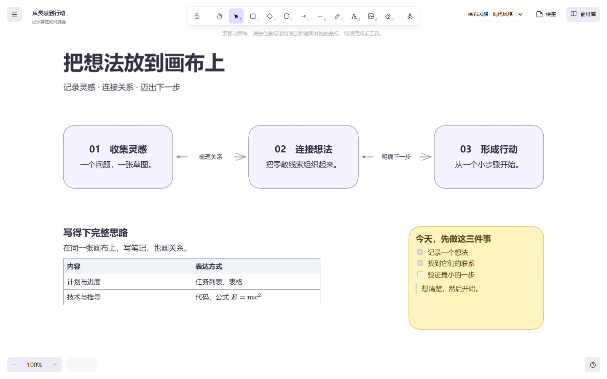
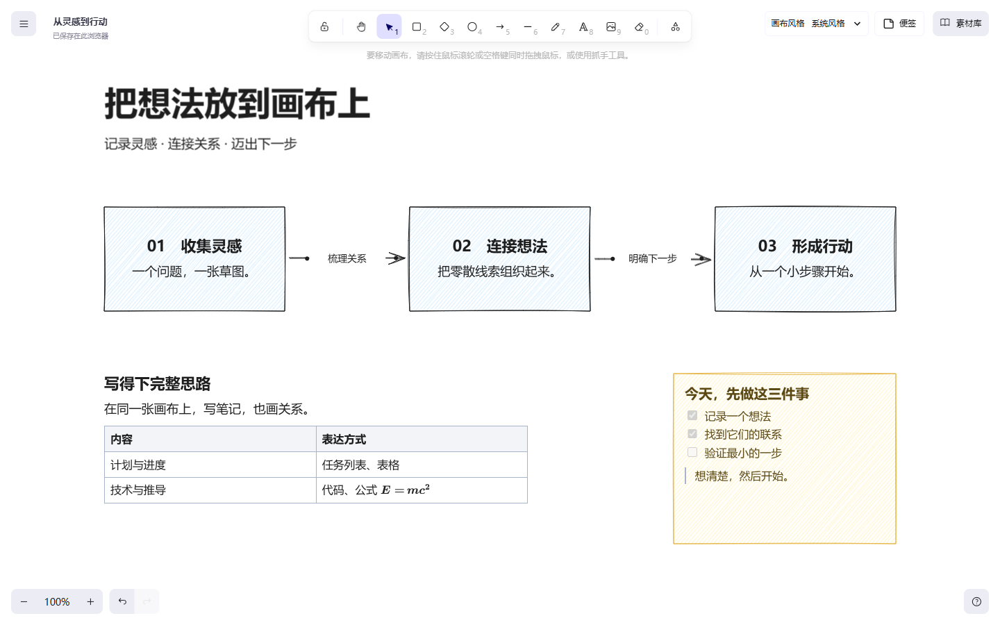

<div align="center">


# Mindflow

**写下想法，连起关系。**

把 Markdown 笔记、流程图和自由草图，放进同一个无限画布。<br />
面向个人桌面使用，无需账号或后端，内容自动保存在当前浏览器。

[核心能力](#核心能力) · [快速开始](#快速开始) · [使用指南](#使用指南) · [保存与备份](#保存与备份)

</div>



<p align="center">当前版本实拍 · 现代风格 · <a href="docs/examples/idea-to-action.excalidraw">打开这份示例画布</a></p>

梳理产品思路、记录学习笔记，或画清一个技术流程：先把零散内容放下来，再用位置与连线组织关系。
文字不必挤成一句标签，节点、便签和连线中都能展开完整的 Markdown 内容。

## 核心能力

| 你想做的事 | Mindflow 提供的方式 |
| --- | --- |
| **写下完整思路** | 原位编辑 Markdown，支持标题、列表、任务、代码、表格、图片与公式；内容自动增高，可调整文字宽度。 |
| **顺着想法继续画** | 从节点四边的连接点拖向已有节点，或拖到空白处创建新节点并立即输入；移动节点时连线跟随。 |
| **让过程流动起来** | 为每条连线单独开启流动圆点、调整速度，用于表达流程、依赖或数据走向。 |
| **自由表达与整理** | 绘制形状、画笔和箭头，拖入或粘贴图片；支持多选、组合、对齐、图层与素材库复用。 |
| **统一画布外观** | 在规整柔和的现代风格与手绘质感的系统风格之间切换，也能继续单独调整元素样式。 |
| **下次接着想** | 自动保存当前画布、图片、偏好与素材库，刷新后恢复；通过文件备份和迁移内容。 |

<details>
<summary>看看同一张画布的系统风格</summary>



在右上角「画布风格」切换。切换会统一当前画布的元素样式，并设置后续绘制的默认值；
已有内容、字号、连接关系与流动配置保留。画布有内容时，风格切换可以整步撤销。

</details>

## 快速开始

需要 **Node.js 22.12+** 和 npm。在 PowerShell 中运行：

```powershell
git clone https://github.com/xiaomingxinggit/mindflow.git
cd mindflow
npm ci
npm run dev
```

打开终端显示的地址，默认是 `http://localhost:5173`。已有本地仓库时，在仓库根目录运行最后两条命令即可。
无需配置环境变量、数据库服务或 API Key。开发和构建命令会自动准备本地编辑器字体。

**先试试截图中的画布：** 下载 [示例文件](docs/examples/idea-to-action.excalidraw)
（在 GitHub 文件页点击下载原始文件），按 `Ctrl / Cmd + /` 打开命令面板，
搜索「打开原生画布文件」并选择它。打开文件会替换当前画布，已有内容请先备份。

## 使用指南

### 从第一个节点开始

1. 按 `R`，在空白处拖出一个矩形；双击节点，写下第一个想法。
2. 按 `Ctrl / Cmd + Enter` 完成编辑。悬停节点，从四边任一连接点拖到空白处，接着输入下一个想法。
3. 想连接已有内容时，将连接点拖向目标节点，目标高亮后释放。移动节点时，箭头保持关联。
4. 点击右上角「便签」记录待办，或将图片拖入画布补充材料。按住 `Space` 拖动浏览，使用左下角控件缩放。

拖线创建的新节点、文字和连线会一起提交，一次撤销即可移除；按 `Escape` 取消或结束空白输入不会留下空节点。
顶部箭头工具 `A` 从节点起笔时也支持这一流程，从空白处起笔则自由绘制箭头。

### 在画布里写 Markdown

双击节点、便签、独立文字或连线标签，即可在原位置编辑。试着粘贴这段内容：

```markdown
## 下一步

- [x] 整理已有材料
- [ ] 验证一个想法

| 方向 | 状态 |
| --- | --- |
| 原型 | 进行中 |

投入与结果：$y = 2x + 1$
```

表格单元格可直接修改，任务可在编辑时勾选；支持 `$…$` 行内公式和 `$$…$$` 块公式。
通过编辑区域的图片按钮上传本地图片，也可直接粘贴图片。

- `Enter` 换行，`Ctrl / Cmd + Enter` 或点击编辑区域外部完成，`Escape` 取消本次编辑。
- 选中含文字的元素后，可通过「文字宽度」调整换行；节点也可拖动角点调宽，内容随之重新排版。
- 节点和便签四周保留统一留白，内容增高时边框一起扩展；编辑与完成后的文字位置保持一致。
- 编辑中的草稿不写入自动保存；完成后作为一次编辑进入撤销历史。

### 给连线加上流动效果

单选一条箭头或线条，在「流动效果」面板开启开关，再拖动速度滑杆。
每条连线独立设置，默认静态；圆点沿线路流动，颜色跟随线色。
终点箭头向前流动，起点箭头反向，双端箭头双向流动。

### 常用快捷键

以下为未编辑文字时的画布快捷键，完整列表见文件菜单中的「帮助」。

| 快捷键 | 操作 |
| --- | --- |
| `V` / `H` | 选择 / 平移工具 |
| `R` / `D` / `O` | 矩形 / 菱形 / 椭圆 |
| `A` / `L` / `P` / `T` / `E` | 箭头 / 线条 / 画笔 / 文字 / 橡皮 |
| 按住 `Space` 拖动 | 临时平移画布 |
| `Ctrl / Cmd + A` | 全选 |
| `Ctrl / Cmd + C`、`V`、`D` | 复制、粘贴、创建副本 |
| `Ctrl / Cmd + G` / `Ctrl / Cmd + Shift + G` | 组合 / 取消组合 |
| `Delete` / `Backspace` | 删除所选内容 |
| `Ctrl / Cmd + Z` / `Ctrl / Cmd + Shift + Z` | 撤销 / 重做 |
| `Ctrl / Cmd + F` | 搜索画布文字 |
| `Ctrl / Cmd + /` | 打开命令面板，输入中文查找工具或操作 |
| `Ctrl / Cmd + S` | 将画布保存为文件 |

命令面板支持方向键选择、`Enter` 执行、`Escape` 关闭。文字编辑期间，键盘操作由原位编辑器处理。

## 保存与备份

**自动保存方便继续工作，文件备份用于长期保留和迁移。** 左上角可修改画布名称，
并查看「保存中…」「已保存在此浏览器」或保存失败提示。

| 方式 | 保存什么 / 如何使用 |
| --- | --- |
| **浏览器自动保存** | 当前画布、图片、名称、主题、视口、画布风格、绘图偏好与素材库保存在 IndexedDB，刷新后恢复。 |
| **可编辑文件备份** | 按 `Ctrl / Cmd + S`，或在命令面板搜索「下载画布文件」，保存 `.excalidraw`；之后用文件菜单「打开」或命令面板恢复。 |
| **图片分享** | 在文件菜单导出 PNG、SVG 或复制为图片，包含 Markdown 渲染内容；流动连线导出为静态图。 |
| **素材库备份** | 通过右侧素材库的导入 / 导出入口保存和恢复可复用元素，素材库与画布文件分别管理。 |

`.excalidraw` 备份包含 Markdown 原文、文字宽度、本地图片和连线流动设置。
SVG 中普通图形为矢量，Markdown 区域以嵌入位图呈现；需要继续编辑时请保留画布文件。

本地数据按浏览器和站点地址隔离，`localhost` 与 `127.0.0.1` 使用不同保存空间。
清理站点数据、切换浏览器或关闭无痕会话可能丢失本地内容，请定期下载备份；保存失败时仍可尝试文件导出。
撤销历史只保留在当前页面会话中。

<details>
<summary>旧版数据与兼容边界</summary>

- 首次打开、没有新白板记录时，会读取旧 `mindflow-flowchart-v1` 数据并转换，原 localStorage 值保持不变。
- 旧版流程图 JSON 可从文件菜单「导入旧版 Mindflow JSON」导入；无效文件显示错误并保留当前内容。
  旧折线与曲线近似转换，已移除的思维导图和系统架构格式不再导入。
- 本项目的 `.excalidraw` 文件在上游编辑器中保留可读文本后备，但不保证相同的 Markdown 编辑体验或流动效果。
- Markdown 外链图片取决于地址可访问性和浏览器跨域条件；本地上传图片随画布备份保存。
- 当前使用单文档工作区，未接入多文档列表、云同步、实时协作或 AI 服务。

</details>

## 开发与贡献

基于 **React + TypeScript + Vite**，使用 Excalidraw 提供绘图、选择、属性、视图与撤销历史；
Mindflow 增加本地工作区、快速连接、Markdown 原位编辑、流动效果与风格预设。

Markdown 编辑使用 Milkdown Crepe，展示使用 markdown-it、KaTeX、DOMPurify 和 html-to-image。
Excalidraw 固定为 `0.18.1`，通过 Vite 适配原位编辑与富内容渲染；升级时需要核对适配版本及源码锚点。

```powershell
npm run build    # TypeScript 检查并构建到 dist/
npm run lint     # Oxlint 静态检查
npm run preview  # 构建后预览生产版本
```

当前未配置 `npm test` 或独立自动测试框架。修改代码后运行构建与静态检查，并验证受影响的桌面浏览器流程。

| 入口 | 内容 |
| --- | --- |
| [贡献约定](AGENTS.md) | 项目结构、代码风格、文档流程与验证要求 |
| [白板实施方案](docs/canvas-redesign-plan.md) | 编辑器集成、本地保存、旧数据迁移与验收记录 |
| [连接、Markdown 与数据流](docs/thought-flow-enhancements.md) | 核心交互、富内容适配、动效与已执行的验证 |
| [画布风格](docs/visual-styles.md) | 两种视觉风格、系统字体与工具颜色偏好 |

感谢 [Excalidraw](https://github.com/excalidraw/excalidraw) 提供白板编辑核心。
其 MIT 许可与版权声明保留在 [excalidraw-LICENSE.txt](public/excalidraw-LICENSE.txt)。
